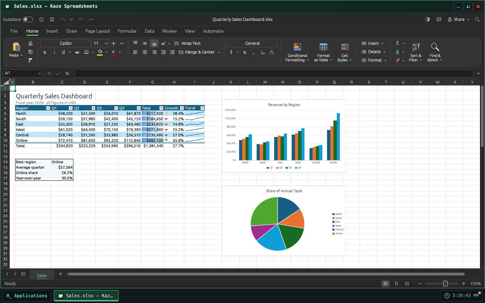
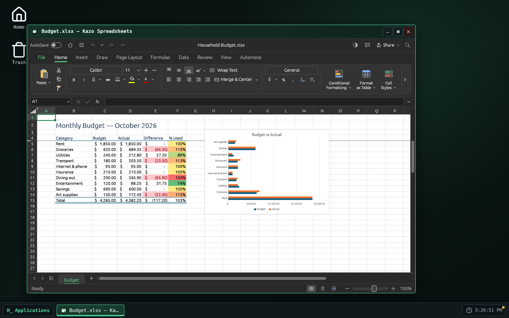
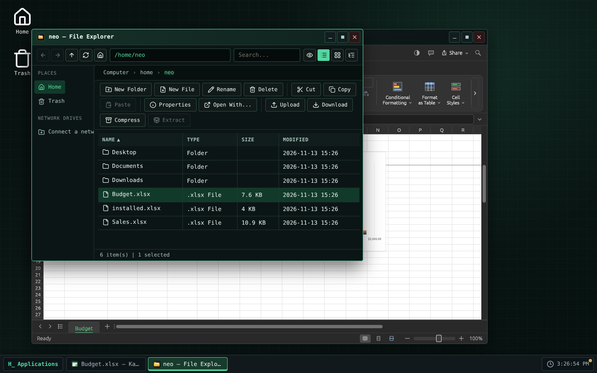

> [Version française](readme-fr.md)

<!-- Store listing: generated from store/ by .github/scripts/store-readme.mjs. Edit store/, then run it. -->


# Kazo Spreadsheets

A spreadsheet for Kazo OS, for `.xlsx`, `.ods` and `.csv` workbooks. Kazo Spreadsheets is based on
[GridCraft](https://github.com/storytold/gridcraft) by the ArtCraft team, an open-source
spreadsheet written in Rust, which runs here in a Kazo OS window.

## Calculate

- Sheets, formulas and the worksheet functions you expect (more than 500), number formats,
  conditional formatting, tables, sorting and filters, charts, pivot tables.
- GridCraft's ribbon, its formula bar, its command search and its shortcuts.
- Several windows at once, each with its own workbooks.

## Your Kazo OS files

- Double-click a `.xlsx`, `.xlsm`, `.xlsb`, `.xls`, `.ods`, `.slk`, `.csv` or `.tsv` file in the
  File Explorer, or use "Open with" on a `.txt` or `.json` file: the workbook opens in Kazo
  Spreadsheets.
- Save writes `.xlsx`. A `.xlsx` you opened is rewritten in place; any other format is never
  overwritten with `.xlsx` data, so its first save asks for a name in the Kazo OS save dialog.
  Save As (F12 or Ctrl+Shift+S) and the first save of a new workbook use that dialog too.
- Exports to PDF, CSV and HTML are copies: the workbook stays bound to its file.
- Closing the window asks before losing unsaved changes, for every open workbook.
- File › Open and the pictures you insert come from Kazo OS files, through the Kazo OS dialog.
- Kazo Spreadsheets follows the OS theme (light or dark) and language; its settings are kept per
  Kazo OS user in `~/.config/ca.kazo.spreadsheets/`.

## Known limits

- **GridCraft is in alpha.** Most workbooks open and save well, but keep a copy of the important
  ones.
- GridCraft's own Save As button (File page) saves under the current name: use F12 or
  Ctrl+Shift+S for Save As.
- **Asian scripts**: the web version of GridCraft has no Chinese, Japanese or Korean font; such text
  may not show, and those interface languages fall back to English.
- GridCraft draws with **WebGPU or WebGL 2**: a browser or computer with neither shows an error
  screen instead of the workbook.
- The download is about 10 MB (27 MB once installed), and each window loads its own copy of
  GridCraft.
- The window stays on the screen where it opened: moving it to another screen would reload
  GridCraft and lose the open workbooks.
- Printing goes through the browser's print dialog.
- Needs Kazo OS 3.3.3 or later.

## License

Kazo Spreadsheets is free software under the MIT license. GridCraft is under the MIT or Apache-2.0
license; its notices and the licenses of the fonts it includes ship with the app (see
`THIRD-PARTY-NOTICES.md` in the repository). The ArtCraft name and logos are trademarks of the
ArtCraft team and are not used by Kazo Spreadsheets.

## Screenshots

<p>
  
  
  
</p>

<!-- /Store listing -->

## Try it

[Open Kazo Spreadsheets in Kazo OS](https://os.kazo.ca/?autolaunch=ca.kazo.spreadsheets): the link starts Kazo OS, installs the app from the official Store and opens it.

Or open [Kazo OS](https://os.kazo.ca/) and install Kazo Spreadsheets from the **Kazo OS Store** (category Productivity), or in the Kazo OS Terminal, as an administrator: `sudo kazopkg install Kazo-ca/Os-App-Spreadsheets`.

## About Kazo OS

[Kazo OS](https://github.com/Kazo-ca/Os) is a simulated operating system that runs in the browser, written in C# with Blazor WebAssembly. It gives a complete environment to build and run applications: desktop and windows, a persistent file system, processes, a POSIX shell, a simulated network, the Kazo OS Store, and a public SDK (NuGet packages) to make apps such as this one. Try it at <https://os.kazo.ca/> (PWA, works offline).

## Development

- Plan: [plan](doc/en/plan.md). GridCraft's notices and the licenses in the package: [THIRD-PARTY-NOTICES.md](THIRD-PARTY-NOTICES.md).

| Folder | Content |
| --- | --- |
| `src/Kazo.Spreadsheets` | The app (window app, its `[AppManifest]` class generates `manifest.json`) |
| `src/Kazo.Spreadsheets.Os` | A host that runs the whole Kazo OS with the base apps and this app: the project to start |
| `tests/Kazo.Spreadsheets.Tests` | Tests of the app |
| `external/KazoOs` | The Kazo OS repository as a git submodule, on a release tag |
| `external/gridcraft` | GridCraft's sources (our fork `Kazo-ca/gridcraft`) as a git submodule, only to compile GridCraft |
| `tests/installed` | The app as the Store installs it, in a published Kazo OS: `kazopkg install`, a workbook opened by double-click, the Store screenshots |
| `THIRD-PARTY-NOTICES.md` | GridCraft and what it bundles; linked into the package with `LICENSE` (`wwwroot/legal/`) |
| `src/Kazo.Spreadsheets/wwwroot/gridcraft` | The GridCraft web build and its provenance `gridcraft.json`, never edited by hand |
| `store/` | What the Kazo OS Store shows: icon (PNG 256×256), short descriptions, descriptions, screenshots, `store.json` |

### First steps

```bash
# A repository created from the GitHub template already has the submodule:
git clone --recurse-submodules <your repository>

# A folder made with "dotnet new kazoos-solution" adds it once:
git init
git submodule add --depth 1 https://github.com/Kazo-ca/Os.git external/KazoOs
git -C external/KazoOs checkout v<Kazo OS version>
```

Then open `Kazo.Spreadsheets.slnx` in Visual Studio or Rider and start `Kazo.Spreadsheets.Os`, or run
`dotnet run --project src/Kazo.Spreadsheets.Os`.

### The Kazo OS version

`external/KazoOs/wasm2/KazoOs/build/Versions.props` is the Kazo OS version of this repository.
To move to another version, move the submodule to its tag and commit it:

```bash
git -C external/KazoOs fetch --depth 1 origin tag v2.2.0
git -C external/KazoOs checkout v2.2.0
git add external/KazoOs
```

Never edit the submodule: the OS is not modified from an app repository, and CI refuses a
submodule with local changes or off its tag.

### Two build profiles

| Profile | Kazo OS comes from | Use |
| --- | --- | --- |
| `Debug` | the projects of the submodule (`KazoOsUseSource=true`) | step into the SDK and the OS, breakpoints anywhere |
| `Release` | the `Kazo.Os.*` packages of nuget.org, at the submodule's version | CI, `dotnet publish`, the Kazo OS Store |

Force either one with `-p:KazoOsUseSource=true` or `false`.

### Tests

```bash
dotnet test                       # unit tests (Debug: the Kazo OS projects of the submodule)
dotnet build -c Debug && npm run test:e2e   # Kazo OS in Chromium with Playwright: GridCraft, open, save, close
```

The app as the Store installs it, in a published Kazo OS (not in CI: a few minutes):

```bash
dotnet build src/Kazo.Spreadsheets -c Release -t:KazoOsPack
# kazoos-wasm-<version>.zip of a Kazo OS release (3.3.3 or later), unzipped in <os>
npm run test:installed -- <os> [packages folder] [screenshots folder]
npm run test:installed -- --store <os>   # after a release: installs from the real Kazo OS Store
```

It installs Kazo Spreadsheets with `sudo kazopkg install Kazo-ca/Os-App-Spreadsheets` (GitHub
answered from the local packages), saves a `.xlsx`, double-clicks it in the File Explorer and
checks Kazo Spreadsheets opens it. With a screenshots folder it also writes the Store's screenshots
(`store/screenshots/`, GridCraft's own sample workbooks). After editing `store/`, run
`npm run store:readme` so the top of this page shows the same listing (CI checks it).

### Building GridCraft from source

The app uses the GridCraft build committed in `src/Kazo.Spreadsheets/wwwroot/gridcraft/`;
building the app does not compile GridCraft. To change GridCraft's version, or to take a fix
of our fork, move the `external/gridcraft` submodule to a commit of the fork
`Kazo-ca/gridcraft` (branch `kazo/v<version>`), merge that, then run the **Build GridCraft**
workflow on the branch from the Actions tab: it compiles, commits the build on
`gridcraft/build-<version>-<commit>`, runs CI there and opens a PR. On a machine:

```bash
git submodule update --init --depth 1 external/gridcraft
rustup target add wasm32-unknown-unknown   # Rust 1.95 or later; Trunk 0.21.14
tools/build-gridcraft.sh
```

`tools/vendor-gridcraft.sh` alone takes back the official zip pinned by SHA-256. The tests
check that the provenance names either that zip or the submodule's commit.

### Publishing to the Kazo OS Store

1. Fill `store/` (icon, short descriptions, descriptions, category and tags in `store.json`).
2. Change `Version` in the app's `[AppManifest]` class and commit it to `main`, then tag it: run the
   **Tag a release** workflow (Actions tab, or the GitHub API for an agent), which tags the head of
   `main` with the manifest's version and starts the two publishing workflows; or push the tag
   yourself: `git tag v1.0.0 && git push --tags`.
3. The **Publish to the Kazo OS Store** workflow builds the app and makes the catalog folder
   `apps/<appId>_<version>/`. With a `HACK_STORE_TOKEN` secret (a token allowed to fork and open
   pull requests), it opens the pull request to `Kazo-ca/Os-AppMarketPlace` from your fork;
   without it, download the run's artifact and open the pull request yourself.

`HACK_STORE_TOKEN` is a GitHub personal access token of yours, not something Kazo OS gives you:

1. GitHub ▸ **Settings** ▸ **Developer settings** ▸ **Personal access tokens** ▸ **Tokens (classic)** ▸
   **Generate new token (classic)**, with a short expiration and the **`repo`** and **`workflow`**
   scopes (a fine-grained token cannot cover both your fork and the catalog's repository).
2. Copy it (shown once) into this repository: **Settings** ▸ **Secrets and variables** ▸ **Actions** ▸
   **New repository secret**, name `HACK_STORE_TOKEN` (or `gh secret set HACK_STORE_TOKEN`).

`repo` reaches all your repositories: keep the token only in this secret and revoke it if in doubt.

The catalog never takes a binary from you: once your pull request is reviewed and merged, its CI
compiles the app at the tagged commit.

### Publishing on the `kazoos-packages` branch

The same `v*` tag also runs **Publish the Kazo OS packages**: it packs the app and pushes it to the
`kazoos-packages` branch of this repository, keeping the versions already published. Kazo OS
users then install it with `kazopkg install <owner>/<repo>`, without the Kazo OS Store.

These packages are not signed: apps are signed only in the Kazo OS Store repository
(`Kazo-ca/Os-AppMarketPlace`), when it builds your app from the catalog (ADR 0219). Kazo OS checks
them by their SHA-256 and asks an administrator before installing from an untrusted source. Users
who want a signed package install your app from the Kazo OS Store.
