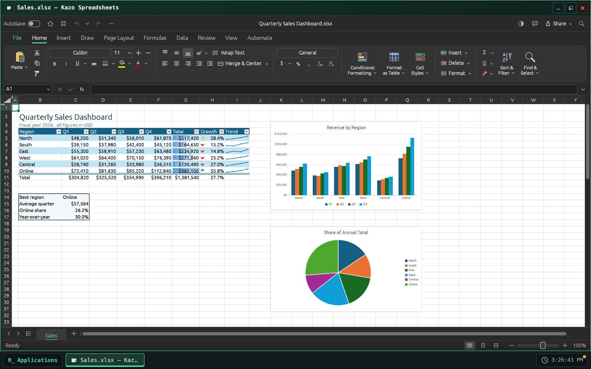
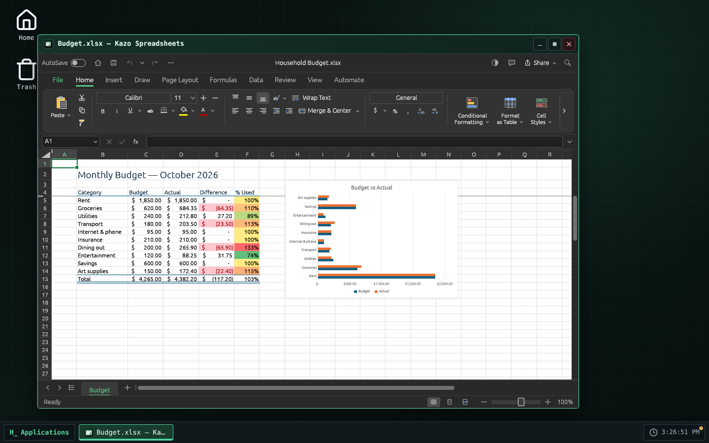
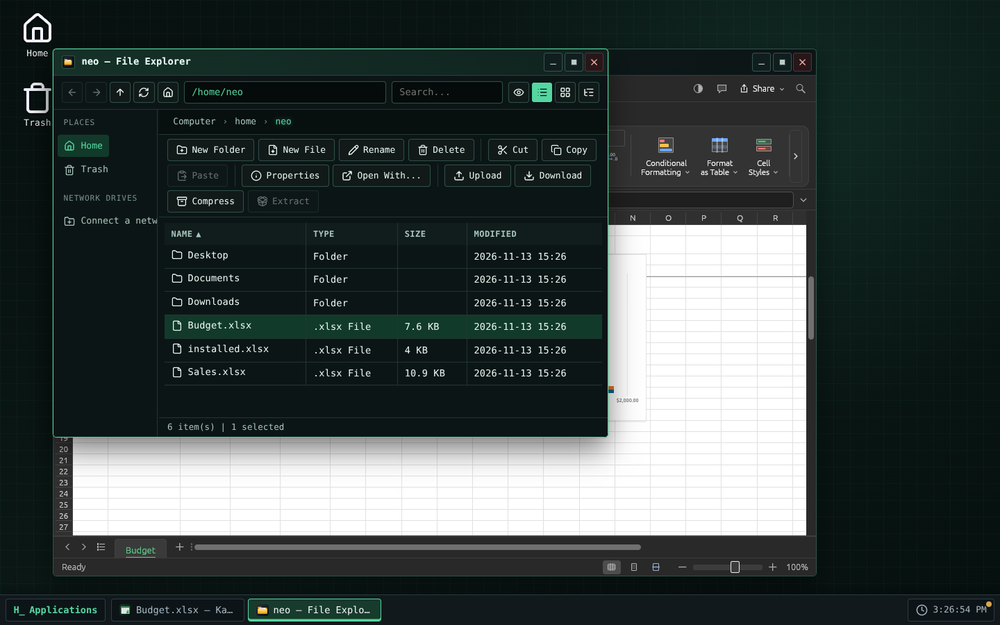

> [English version](README.md)

<!-- Fiche du Store : générée depuis store/ par .github/scripts/store-readme.mjs. Modifiez store/, puis lancez-le. -->


# Kazo Spreadsheets

Un tableur pour Kazo OS, pour les classeurs `.xlsx`, `.ods` et `.csv`. Kazo Spreadsheets est basé
sur [GridCraft](https://github.com/storytold/gridcraft) de l'équipe ArtCraft, un tableur libre
écrit en Rust, qui tourne ici dans une fenêtre de Kazo OS.

## Calculer

- Feuilles, formules et les fonctions de feuille de calcul attendues (plus de 500), formats de
  nombre, mise en forme conditionnelle, tableaux, tri et filtres, graphiques, tableaux croisés
  dynamiques.
- Le ruban de GridCraft, sa barre de formule, sa recherche de commandes et ses raccourcis.
- Plusieurs fenêtres à la fois, chacune avec ses classeurs.

## Vos fichiers Kazo OS

- Double-cliquez sur un fichier `.xlsx`, `.xlsm`, `.xlsb`, `.xls`, `.ods`, `.slk`, `.csv` ou `.tsv`
  dans l'Explorateur de fichiers, ou utilisez « Ouvrir avec » sur un fichier `.txt` ou `.json` :
  le classeur s'ouvre dans Kazo Spreadsheets.
- Enregistrer écrit du `.xlsx`. Un `.xlsx` ouvert est réécrit en place ; un autre format n'est
  jamais écrasé par des données `.xlsx`, donc son premier enregistrement demande un nom dans le
  dialogue d'enregistrement de Kazo OS. Enregistrer sous (F12 ou Ctrl+Maj+S) et le premier
  enregistrement d'un nouveau classeur passent aussi par ce dialogue.
- Les exportations en PDF, CSV et HTML sont des copies : le classeur reste lié à son fichier.
- Fermer la fenêtre demande avant de perdre des modifications, pour chaque classeur ouvert.
- Fichier › Ouvrir et les images insérées viennent des fichiers Kazo OS, par le dialogue de
  Kazo OS.
- Kazo Spreadsheets suit le thème (clair ou sombre) et la langue de l'OS ; ses réglages sont gardés
  par utilisateur Kazo OS dans `~/.config/ca.kazo.spreadsheets/`.

## Limites connues

- **GridCraft est en alpha.** La plupart des classeurs s'ouvrent et s'enregistrent bien, mais
  gardez une copie des plus importants.
- Le bouton Enregistrer sous de GridCraft (page Fichier) enregistre sous le nom actuel : utilisez
  F12 ou Ctrl+Maj+S pour Enregistrer sous.
- **Écritures asiatiques** : la version web de GridCraft n'a pas de police chinoise, japonaise ou
  coréenne ; ce texte peut ne pas s'afficher, et ces langues d'interface passent en anglais.
- GridCraft dessine avec **WebGPU ou WebGL 2** : un navigateur ou un ordinateur sans l'un ni l'autre
  montre un écran d'erreur au lieu du classeur.
- Le téléchargement fait environ 10 Mo (27 Mo une fois installé), et chaque fenêtre charge sa propre
  copie de GridCraft.
- La fenêtre reste sur l'écran où elle s'est ouverte : la passer sur un autre écran rechargerait
  GridCraft et perdrait les classeurs ouverts.
- L'impression passe par le dialogue d'impression du navigateur.
- Demande Kazo OS 3.3.3 ou plus récent.

## Licence

Kazo Spreadsheets est un logiciel libre sous licence MIT. GridCraft est sous licence MIT ou
Apache-2.0 ; ses avis et les licences des polices qu'il contient sont livrés avec l'app (voir
`THIRD-PARTY-NOTICES-fr.md` dans le dépôt). Le nom et les logos ArtCraft sont des marques de
l'équipe ArtCraft et ne sont pas utilisés par Kazo Spreadsheets.

## Captures d'écran

<p>
  
  
  
</p>

<!-- /Fiche du Store -->

## Essayer

[Ouvrir Kazo Spreadsheets dans Kazo OS](https://os.kazo.ca/?autolaunch=ca.kazo.spreadsheets) : le lien démarre Kazo OS, installe l'app depuis le Store officiel et l'ouvre.

Ou ouvrez [Kazo OS](https://os.kazo.ca/) et installez Kazo Spreadsheets depuis le **Kazo OS Store** (catégorie Productivité), ou dans le Terminal de Kazo OS, en administrateur : `sudo kazopkg install Kazo-ca/Os-App-Spreadsheets`.

## À propos de Kazo OS

[Kazo OS](https://github.com/Kazo-ca/Os) est un système d'exploitation simulé qui tourne dans le navigateur, écrit en C# avec Blazor WebAssembly. Il offre un environnement complet pour développer et exécuter des applications : bureau et fenêtres, système de fichiers persistant, processus, shell POSIX, réseau simulé, le Kazo OS Store, et un SDK public (paquets NuGet) pour créer des apps comme celle-ci. Essayez-le sur <https://os.kazo.ca/> (PWA, fonctionne hors ligne).

## Développement

- Plan : [plan](doc/fr/plan.md). Les avis de GridCraft et les licences du paquet : [THIRD-PARTY-NOTICES-fr.md](THIRD-PARTY-NOTICES-fr.md).

| Dossier | Contenu |
| --- | --- |
| `src/Kazo.Spreadsheets` | L'app (app fenêtrée ; sa classe `[AppManifest]` génère `manifest.json`) |
| `src/Kazo.Spreadsheets.Os` | Un hôte qui lance tout Kazo OS avec les apps de base et cette app : le projet à démarrer |
| `tests/Kazo.Spreadsheets.Tests` | Les tests de l'app |
| `external/KazoOs` | Le dépôt Kazo OS en sous-module git, sur un tag de release |
| `external/gridcraft` | Les sources de GridCraft (notre fork `Kazo-ca/gridcraft`) en sous-module git, seulement pour compiler GridCraft |
| `tests/installed` | L'app telle que le Store l'installe, dans un Kazo OS publié : `kazopkg install`, un classeur ouvert par double-clic, les captures du Store |
| `THIRD-PARTY-NOTICES-fr.md` | GridCraft et ce qu'il embarque ; lié dans le paquet avec `LICENSE` (`wwwroot/legal/`) |
| `src/Kazo.Spreadsheets/wwwroot/gridcraft` | Le build web de GridCraft et sa provenance `gridcraft.json`, jamais modifiés à la main |
| `store/` | Ce que montre le Kazo OS Store : icône (PNG 256×256), descriptions courtes, descriptions, captures, `store.json` |

### Premiers pas

```bash
# Un dépôt créé depuis le template GitHub a déjà le sous-module :
git clone --recurse-submodules <votre dépôt>

# Un dossier créé par « dotnet new kazoos-solution » l'ajoute une fois :
git init
git submodule add --depth 1 https://github.com/Kazo-ca/Os.git external/KazoOs
git -C external/KazoOs checkout v<version de Kazo OS>
```

Ouvrez ensuite `Kazo.Spreadsheets.slnx` dans Visual Studio ou Rider et démarrez `Kazo.Spreadsheets.Os`,
ou lancez `dotnet run --project src/Kazo.Spreadsheets.Os`.

### La version de Kazo OS

`external/KazoOs/wasm2/KazoOs/build/Versions.props` est la version de Kazo OS de ce dépôt.
Pour changer de version, placez le sous-module sur son tag et validez-le :

```bash
git -C external/KazoOs fetch --depth 1 origin tag v2.2.0
git -C external/KazoOs checkout v2.2.0
git add external/KazoOs
```

Ne modifiez jamais le sous-module : on ne modifie pas l'OS depuis un dépôt d'app, et la CI refuse
un sous-module modifié ou hors de son tag.

### Deux profils de build

| Profil | Kazo OS vient de | Usage |
| --- | --- | --- |
| `Debug` | les projets du sous-module (`KazoOsUseSource=true`) | entrer dans le SDK et l'OS, points d'arrêt partout |
| `Release` | les paquets `Kazo.Os.*` de nuget.org, à la version du sous-module | CI, `dotnet publish`, le Kazo OS Store |

Forcez l'un ou l'autre avec `-p:KazoOsUseSource=true` ou `false`.

### Tests

```bash
dotnet test                       # tests unitaires (Debug : les projets Kazo OS du sous-module)
dotnet build -c Debug && npm run test:e2e   # Kazo OS dans Chromium avec Playwright : GridCraft, ouvrir, enregistrer, fermer
```

L'app telle que le Store l'installe, dans un Kazo OS publié (pas dans la CI : quelques minutes) :

```bash
dotnet build src/Kazo.Spreadsheets -c Release -t:KazoOsPack
# kazoos-wasm-<version>.zip d'une version de Kazo OS (3.3.3 ou plus), décompressé dans <os>
npm run test:installed -- <os> [dossier des paquets] [dossier des captures]
npm run test:installed -- --store <os>   # après une version : installe depuis le vrai Kazo OS Store
```

Il installe Kazo Spreadsheets avec `sudo kazopkg install Kazo-ca/Os-App-Spreadsheets` (GitHub
répondu depuis les paquets locaux), enregistre un `.xlsx`, double-clique dessus dans l'Explorateur
de fichiers et vérifie que Kazo Spreadsheets l'ouvre. Avec un dossier de captures, il écrit aussi
les captures du Store (`store/screenshots/`, les classeurs d'exemple de GridCraft). Après une
modification de `store/`, lancer `npm run store:readme` pour que le haut de cette page montre la
même fiche (la CI le vérifie).

### Compiler GridCraft depuis les sources

L'app utilise le build de GridCraft versionné dans `src/Kazo.Spreadsheets/wwwroot/gridcraft/` ;
construire l'app ne compile pas GridCraft. Pour changer de version de GridCraft, ou prendre un
correctif de notre fork, déplacer le sous-module `external/gridcraft` sur un commit du fork
`Kazo-ca/gridcraft` (branche `kazo/v<version>`), fusionner, puis lancer le workflow
**Build GridCraft** sur la branche depuis l'onglet Actions : il compile, valide le build sur
`gridcraft/build-<version>-<commit>`, y lance la CI et ouvre une PR. Sur un poste :

```bash
git submodule update --init --depth 1 external/gridcraft
rustup target add wasm32-unknown-unknown   # Rust 1.95 ou plus ; Trunk 0.21.14
tools/build-gridcraft.sh
```

`tools/vendor-gridcraft.sh` seul reprend le zip officiel épinglé par SHA-256. Les tests vérifient
que la provenance nomme soit ce zip, soit le commit du sous-module.

### Publier dans le Kazo OS Store

1. Remplissez `store/` (icône, descriptions courtes, descriptions, catégorie et étiquettes dans `store.json`).
2. Changez `Version` dans la classe `[AppManifest]` de l'app et validez-la dans `main`, puis posez le
   tag : lancez le workflow **Tag a release** (onglet Actions, ou l'API GitHub pour un agent), qui pose
   sur la tête de `main` le tag de la version du manifeste et lance les deux workflows de
   publication ; ou poussez le tag vous-même : `git tag v1.0.0 && git push --tags`.
3. Le workflow **Publish to the Kazo OS Store** compile l'app et produit le dossier du catalogue
   `apps/<appId>_<version>/`. Avec un secret `HACK_STORE_TOKEN` (un jeton qui peut créer un fork et
   ouvrir des pull requests), il ouvre la pull request vers `Kazo-ca/Os-AppMarketPlace` depuis
   votre fork ; sans lui, téléchargez l'artefact du workflow et ouvrez la pull request vous-même.

`HACK_STORE_TOKEN` est un jeton d'accès personnel GitHub à vous, que Kazo OS ne fournit pas :

1. GitHub ▸ **Settings** ▸ **Developer settings** ▸ **Personal access tokens** ▸ **Tokens (classic)** ▸
   **Generate new token (classic)**, avec une expiration courte et les scopes **`repo`** et
   **`workflow`** (un jeton à grain fin ne peut pas couvrir à la fois votre fork et le dépôt du catalogue).
2. Copiez-le (affiché une seule fois) dans ce dépôt : **Settings** ▸ **Secrets and variables** ▸
   **Actions** ▸ **New repository secret**, nom `HACK_STORE_TOKEN` (ou `gh secret set HACK_STORE_TOKEN`).

`repo` donne accès à tous vos dépôts : gardez le jeton dans ce seul secret et révoquez-le au moindre doute.

Le catalogue ne prend jamais de binaire de votre part : une fois votre pull request relue et
fusionnée, sa CI compile l'app au commit du tag.

### Publier sur la branche `kazoos-packages`

Le même tag `v*` lance aussi **Publish the Kazo OS packages** : il fait le paquet de l'app et le
pousse sur la branche `kazoos-packages` de ce dépôt, en gardant les versions déjà publiées. Les
utilisateurs de Kazo OS l'installent alors avec `kazopkg install <owner>/<repo>`, sans le Kazo OS Store.

Ces paquets ne sont pas signés : les apps sont signées seulement dans le dépôt du Kazo OS Store
(`Kazo-ca/Os-AppMarketPlace`), quand il compile votre app depuis le catalogue (ADR 0219). Kazo OS
les vérifie par leur SHA-256 et demande un administrateur avant d'installer depuis une source non
fiable. Pour un paquet signé, installez l'app depuis le Kazo OS Store.
